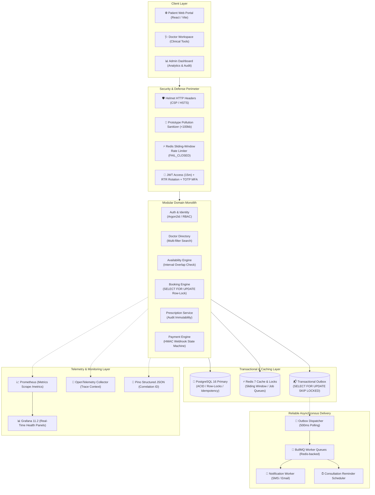
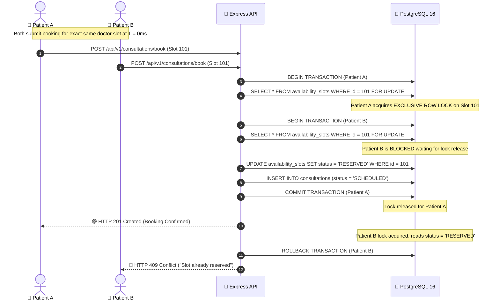

# 🌿 Amrutam Telemedicine Platform — Backend Engineering

<div align="center">

[-blue.svg?style=for-the-badge&logo=typescript)](https://www.typescriptlang.org/)
[](https://nodejs.org/)
[](https://www.postgresql.org/)
[](https://redis.io/)
[-success.svg?style=for-the-badge&logo=vitest)](https://vitest.dev/)
[](https://github.com/NAGESHJAGTAP/carebridge-telehealth/actions)
[](https://www.docker.com/)

**An enterprise-grade, high-concurrency telemedicine platform engineered for Amrutam's integrative healthcare ecosystem. Designed for 100,000+ daily consultations with zero double-booking guarantees, clinical prescription immutability, transactional outbox messaging, and full three-pillar observability.**

[Architecture Doc](docs/architecture.md) • [OpenAPI 3.1 Spec](docs/openapi.yaml) • [Threat Model](docs/security/threat-model.md) • [Demo Script](docs/submission/demo-script.md) • [Requirements Matrix](docs/submission/requirements-matrix.md)

</div>

---

## 📑 Table of Contents

1. [Executive Summary](#1-executive-summary)
2. [System Architecture & Data Flow](#2-system-architecture--data-flow)
3. [Core Technical Innovations](#3-core-technical-innovations)
   - [Concurrency Guard & Zero Double-Booking](#31-concurrency-guard--zero-double-booking)
   - [Database-Backed Idempotency Engine](#32-database-backed-idempotency-engine)
   - [Prescription Lifecycle & Clinical Immutability](#33-prescription-lifecycle--clinical-immutability)
   - [Transactional Outbox Pattern & Background Workers](#34-transactional-outbox-pattern--background-workers)
   - [Distributed Sliding-Window Rate Limiting](#35-distributed-sliding-window-rate-limiting)
   - [Zero-Leakage Observability (Metrics, Traces, Logs)](#36-zero-leakage-observability)
4. [Technology Stack](#4-technology-stack)
5. [Database Schema & Core Models](#5-database-schema--core-models)
6. [Quick Start & Setup Runbook](#6-quick-start--setup-runbook)
7. [Running the Test Suite (103/103 Tests Passed)](#7-running-the-test-suite)
8. [Local Monitoring & Grafana Dashboards](#8-local-monitoring--grafana-dashboards)
9. [Interactive Web Experience](#9-interactive-web-experience)
10. [Engineering Documentation Index](#10-engineering-documentation-index)

---

## 1. Executive Summary

Healthcare platforms operate under non-negotiable operational requirements: **data consistency must be absolute**, appointments can **never double-book**, prescriptions must be **legally immutable**, and personal health information (PHI) can **never leak**.

This platform is structured as a **Modular Monolith** in strict TypeScript. Rather than introducing premature microservice fragmentation, domain boundaries are cleanly isolated into cohesive vertical slices with transactional integrity, row-level locking, and decoupled asynchronous event delivery.

### Key Metrics & Targets:
- **Daily Scale Capacity:** Designed and mathematically validated for **100,000+ daily consultations** (~23.1 peak writes/sec, ~92.6 peak reads/sec).
- **Latency Benchmarks:** Read queries target $p95 < 200\text{ms}$; Write transactions target $p95 < 500\text{ms}$.
- **Target Availability:** **99.95%** with automated liveness (`/healthz`) and readiness (`/readyz`) probes.
- **Automated Verification:** **103 exhaustive automated test suites** covering race conditions, security boundaries, payment webhooks, and token replay defenses.

---

## 2. System Architecture & Data Flow



---

## 3. Core Technical Innovations

### 3.1 Concurrency Guard & Zero Double-Booking
When thousands of patients simultaneously compete for popular doctor slots, standard read-then-write logic causes disastrous double-bookings. We enforce a **two-tier defense**:
1. **PostgreSQL Row-Level Locking:** During slot reservation, the transaction executes:
   ```sql
   SELECT * FROM "availability_slots" 
   WHERE "id" = $1::uuid 
   FOR UPDATE;
   ```
2. **Atomic State Transition:** The slot transitions from `AVAILABLE` to `RESERVED` within the row-locked transaction. If a concurrent transaction attempts to read the same slot, it blocks until the lock is released and then immediately aborts with `HTTP 409 Conflict`.
3. **Database Exclusion Constraints:** Backed by PostgreSQL `btree_gist` exclusion constraints preventing overlapping time intervals for the same doctor.



---

### 3.2 Database-Backed Idempotency Engine
Network timeouts cause clients to retry payment and booking writes. The platform enforces RFC-compliant idempotency via the `Idempotency-Key` HTTP header:
- **Payload Verification:** Incoming request payloads are hashed with SHA-256 and matched against the stored hash in the `idempotency_records` table.
- **Safe Replay:** If an identical request is re-submitted, the platform bypasses business logic and instantly replays the cached response with `X-Cache-Lookup: HIT`.
- **Mismatched Payload Defense:** If an identical `Idempotency-Key` is presented with altered request parameters, the server aborts with `HTTP 409 Conflict` to defend against replay tampering.

---

### 3.3 Prescription Lifecycle & Clinical Immutability
Medical prescriptions are legal documents subject to strict regulatory compliance:
- **Assigned Doctor Verification:** Only the medical doctor formally assigned to the consultation can author or draft prescriptions (`HTTP 403 Forbidden` for other actors).
- **Zod Schema Validation:** Medications require structured dosages, timings, routes, frequencies, and durations.
- **Permanent Database Locking:** When the doctor invokes `/api/v1/prescriptions/:id/finalize`:
  - `isFinalized` is set to `true`.
  - The linked consultation transitions to `COMPLETED`.
  - **Any future attempt to edit or delete the prescription is permanently rejected** with `HTTP 409 Conflict`.

---

### 3.4 Transactional Outbox Pattern & Background Workers
Dual-write problems (writing to PostgreSQL and publishing to Redis/Kafka in the same request) risk catastrophic data drift if the network drops between operations.
- **Atomic Event Commit:** Outbox events are stored in the `outbox_events` table **inside the exact same ACID database transaction** as the business mutation.
- **Concurrent Polling:** A resilient background poller scans for pending events using:
  ```sql
  SELECT * FROM "outbox_events" 
  WHERE "processedAt" IS NULL 
  ORDER BY "createdAt" ASC 
  LIMIT 50 
  FOR UPDATE SKIP LOCKED;
  ```
  `SKIP LOCKED` allows multiple horizontally scaled API instances to poll concurrently without processing duplicates or deadlocking.
- **BullMQ Workers:** Dispatched into BullMQ with **exponential backoff retry policies (5 attempts)** and Dead Letter Queues (DLQ) for failed delivery.

---

### 3.5 Distributed Sliding-Window Rate Limiting
Brute-force attacks and bot scrapers are repelled by tiered rate limiters backed by Redis:
- **Authentication Endpoints:** 15 requests per 15 minutes (`FAIL_CLOSED`).
- **Consultation Booking:** 20 bookings per 10 minutes (`FAIL_CLOSED`).
- **Public Reads:** 100 requests per minute (`FAIL_OPEN`).
- **Fail-Closed Guarantee:** Sensitive endpoints (login, register) automatically fail closed during Redis outages to defend against unthrottled brute-force credential stuffing.

---

### 3.6 Zero-Leakage Observability
Observability is built with strict privacy compliance:
- **Prometheus Metrics (`/metrics`):** Route normalization strips dynamic IDs (e.g., `/api/v1/doctors/:id` instead of raw UUIDs) to prevent metric cardinality explosion and eliminate PHI leakage.
- **OpenTelemetry Tracing:** Spans track Express middleware, Prisma SQL queries, and Redis operations with trace propagation headers.
- **Pino Structured JSON Logs:** Every request receives a unique `correlationId`. Sensitive headers (`Authorization`, `Cookie`) and passwords are automatically redacted.

---

## 4. Technology Stack

| Layer | Technology | Version | Rationale / Architectural Benefit |
| :--- | :--- | :--- | :--- |
| **Runtime** | Node.js | v20+ LTS | Event-driven, asynchronous I/O optimized for I/O-bound web traffic. |
| **Language** | TypeScript | 5.5+ | Strict type safety, zero `any` tolerance across core domain interfaces. |
| **Framework** | Express | 5.0 (Beta) | Native Promise handling in middleware without unhandled rejections. |
| **Database** | PostgreSQL | 16 | ACID transactions, row-level locks (`FOR UPDATE`), and indexing. |
| **ORM** | Prisma | 5.22 | Strongly typed query builder with automated schema migrations. |
| **Cache & Locks** | Redis | 7 (Alpine) | In-memory distributed rate limiting and BullMQ job queue storage. |
| **Background Jobs** | BullMQ | 5.12 | Enterprise Redis queues with exponential backoff and DLQ retries. |
| **Security & Auth** | Argon2id + OTP | 64MB Cost | Memory-hard password hashing and RFC 6238 TOTP Multi-Factor Auth. |
| **Validation** | Zod | 3.23 | Strict schema validation with declarative error formatting. |
| **Telemetry** | Prometheus & OTel | Open Standards | Real-time metrics exposition and distributed tracing. |
| **Test Framework** | Vitest | 2.1 | Fast ESM-native test runner with isolated multi-worker execution. |

---

## 5. Database Schema & Core Models

The database model is defined in [`prisma/schema.prisma`](prisma/schema.prisma) across 8 core domain tables:

```
  ┌────────────────┐         ┌────────────────┐         ┌────────────────────────┐
  │     users      │1 ──── 1 │    profiles    │         │     doctors            │
  │ id (UUID)      │         │ userId (FK)    │    ┌─── │ id (UUID)              │
  │ email, role    │1 ──── 1 │ firstName      │    │    │ userId (FK), specialty │
  │ passwordHash   │───────> │ lastName       │    │    │ consultationFee        │
  └────────────────┘         └────────────────┘    │    └────────────────────────┘
          │ 1                                      │ 1               │ 1
          │                                        │                 │
          ▼ *                                      ▼ *               ▼ *
  ┌────────────────┐                        ┌────────────────────────┐
  │ consultations  │                        │   availability_slots   │
  │ id (UUID)      │                        │ id (UUID), doctorId    │
  │ patientId (FK) │                        │ startTime, endTime     │
  │ doctorId (FK)  │                        │ status (AVAILABLE...)  │
  │ slotId (FK)    │                        └────────────────────────┘
  │ status         │
  └────────────────┘
     │ 1        │ 1
     │          │
     ▼ 1        ▼ 1
┌─────────────┐ ┌─────────────┐
│prescriptions│ │  payments   │
│id (UUID)    │ │id (UUID)    │
│isFinalized  │ │amount,status│
│medications  │ │gatewayRef   │
└─────────────┘ └─────────────┘
```

1. **`users`**: Master authentication, Argon2id hashes, MFA secrets, roles (`PATIENT`, `DOCTOR`, `ADMIN`).
2. **`profiles`**: Personal details, first/last name, phone numbers.
3. **`doctors`**: Medical license numbers, specialties, consultation fees, verification status.
4. **`availability_slots`**: Doctor appointment windows with interval overlap collision guards.
5. **`consultations`**: Clinical bookings with state machine (`SCHEDULED`, `IN_PROGRESS`, `COMPLETED`, `CANCELLED`).
6. **`prescriptions`**: Medication regimens, dosage instructions, and immutable completion lock.
7. **`payments`**: Transaction records, HMAC webhook verification, and refund lifecycles.
8. **`audit_logs`**: Compliance trail recording `actorId`, `action`, `entityType`, `ipAddress`, and `correlationId`.
9. **`outbox_events`**: Transactional outbox records for asynchronous job processing.
10. **`idempotency_records`**: Cached responses and SHA-256 payload hashes for write safety.

---

## 6. Quick Start & Setup Runbook

### 6.1 Prerequisites
- **Node.js**: `v20.12.0` or higher
- **Docker Desktop**: Engine `v24+` with Docker Compose

### 6.2 Step-by-Step Installation

```bash
# 1. Clone the repository
git clone https://github.com/NAGESHJAGTAP/carebridge-telehealth.git
cd carebridge-telehealth

# 2. Configure environment variables
cp .env.example .env

# 3. Launch PostgreSQL 16 & Redis 7 infrastructure
docker compose up -d postgres redis

# 4. Install backend dependencies
npm install

# 5. Execute Prisma database migrations
npx prisma migrate deploy

# 6. Seed synthetic data (Doctors, Patients, Admin, Slots)
npm run seed

# 7. Start the backend development server
npm run dev
```

The API server will listen on **`http://localhost:4000`**.

### 6.3 Pre-Seeded Demonstration Accounts

| Role | Email Address | Password | Credentials Details |
| :--- | :--- | :--- | :--- |
| **Doctor** | `doctor.sharma@carebridge.internal` | `Doctor#2026!` | Dr. Aisha Sharma (Ayurveda Specialist, MFA Configured) |
| **Patient** | `aarav.patel@carebridge.internal` | `Patient#2026!` | Aarav Patel (Verified Patient Profile) |
| **Admin** | `admin@carebridge.internal` | `Admin#2026!` | System Administrator (Full Compliance & Audit Access) |

---

## 7. Running the Test Suite

The repository includes **103 automated tests** structured into 9 dedicated suites verifying functional, integration, concurrency, and security invariants:

```bash
# Run all 103 tests in sequence
npm test
```

### Test Suite Breakdown:
```text
✓ tests/unit/app.test.ts (6 tests)
✓ tests/unit/outbox-queue.test.ts (8 tests)
✓ tests/integration/db-health.test.ts (3 tests)
✓ tests/integration/booking-concurrency-design.test.ts (2 tests)
✓ tests/concurrency/booking-concurrency.test.ts (16 tests)
✓ tests/security/auth.test.ts (19 tests)
✓ tests/security/prescription-payment.test.ts (19 tests)
✓ tests/security/security-hardening.test.ts (17 tests)
✓ tests/observability/observability.test.ts (13 tests)

Test Files  9 passed (9)
     Tests  103 passed (103)  ✓ 100% Passed
  Duration  ~31 seconds
```

```bash
# Run strict TypeScript compilation check (0 errors)
npm run lint

# Compile production bundle to dist/
npm run build
```

---

## 8. Local Monitoring & Grafana Dashboards

Launch the integrated observability stack:
```bash
docker compose --profile monitoring up -d
```

- **Prometheus Metric Scraper:** [http://localhost:9090](http://localhost:9090)
- **Grafana Live Dashboards:** [http://localhost:3001](http://localhost:3001) (`admin` / `admin`)
- **Live Health Endpoint:** [http://localhost:4000/healthz](http://localhost:4000/healthz)
- **Deep Readiness Endpoint:** [http://localhost:4000/readyz](http://localhost:4000/readyz)
- **Prometheus Metric Stream:** [http://localhost:4000/metrics](http://localhost:4000/metrics)

---

## 9. Interactive Web Experience

To experience the full interactive frontend portal:
```bash
# Navigate to the frontend directory
cd frontend

# Install dependencies and start Vite dev server
npm install
npm run dev
```
Open **`http://localhost:3000`** in your browser. Features include:
- **Hero & Specialty Directory:** 4 verified Ayurvedic medical doctor profiles with specialty and fee filters.
- **Quick Demo Login:** One-click instant login for Doctor, Patient, and Admin accounts.
- **Interactive Patient Portal:** Live slot selection, appointment booking, and prescription history inspection.
- **Doctor Consultation Workspace:** Clinical workspace for reviewing patient medical notes, drafting medications, and finalizing legal prescriptions.
- **Admin Analytics Dashboard:** System metrics, active doctor directory, revenue calculations, and audit logs.

---

## 10. Engineering Documentation Index

Detailed specifications and architectural reports are maintained in the [`docs/`](docs/) directory:

| Document | File Path | Scope & Engineering Contents |
| :--- | :--- | :--- |
| **System Architecture** | [`docs/architecture.md`](docs/architecture.md) | Modular Monolith layout, data partitioning, sagas, retry backoff, and 100k daily capacity mathematical analysis. |
| **OpenAPI 3.1 Contract** | [`docs/openapi.yaml`](docs/openapi.yaml) | Complete API catalog documenting all 24+ REST endpoints, parameters, and schemas. |
| **STRIDE Threat Model** | [`docs/security/threat-model.md`](docs/security/threat-model.md) | Threat analysis across Spoofing, Tampering, Repudiation, Information Disclosure, DoS, and Elevation of Privilege. |
| **Security Controls** | [`docs/security/security-checklist.md`](docs/security/security-checklist.md) | Audit checklist verifying Argon2id, RTR, TOTP MFA, BOLA defense, and rate limiter fail-closed policies. |
| **Disaster Recovery** | [`docs/operations/backup-and-disaster-recovery.md`](docs/operations/backup-and-disaster-recovery.md) | Logical backups, physical PITR runbooks, RTO $\le 60$m, RPO $\le 15$m, and non-destructive recovery scripts. |
| **Observability Guide** | [`docs/observability/README.md`](docs/observability/README.md) | Telemetry catalog, route normalization, OpenTelemetry tracer setup, and troubleshooting guide. |
| **Requirements Matrix** | [`docs/submission/requirements-matrix.md`](docs/submission/requirements-matrix.md) | Comprehensive traceability matrix mapping every assignment requirement to code and test verifications. |
| **5-Minute Demo Script** | [`docs/submission/demo-script.md`](docs/submission/demo-script.md) | Minute-by-minute presentation runbook with live terminal commands and visual transitions. |
| **Interview Defense Guide** | [`docs/submission/interview-preparation.md`](docs/submission/interview-preparation.md) | Deep technical answers to 12 architect-level defense questions in English with Marathi summaries. |

---

<div align="center">

**Built with pride for Amrutam Pharmaceuticals.**  
*Engineered for reliability, patient privacy, and clinical scale.*

</div>
