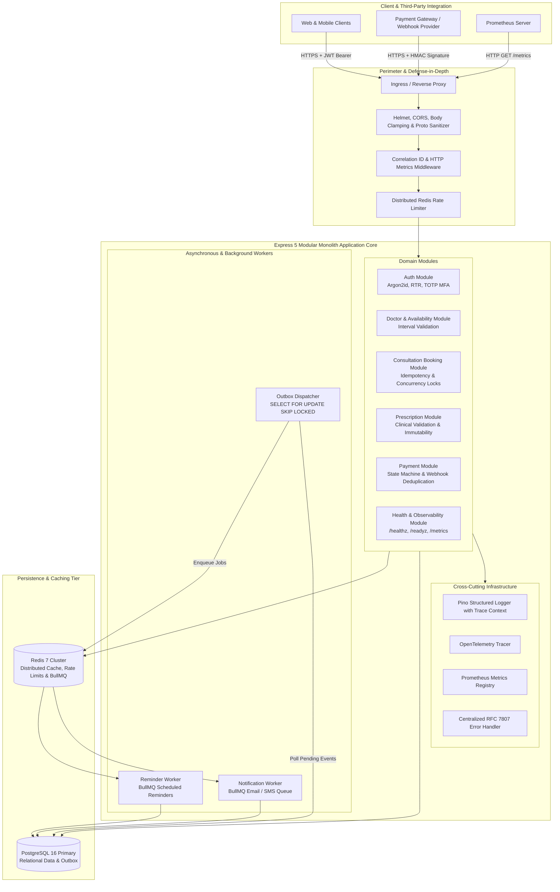
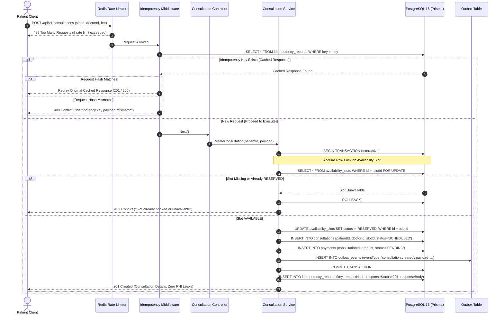
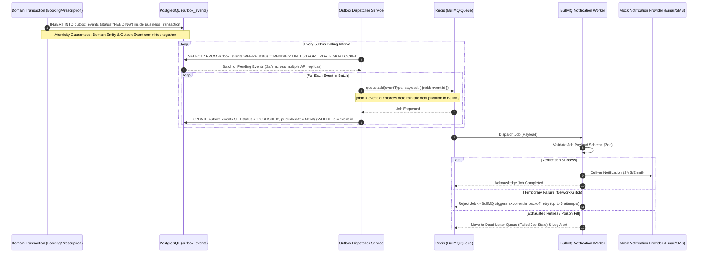
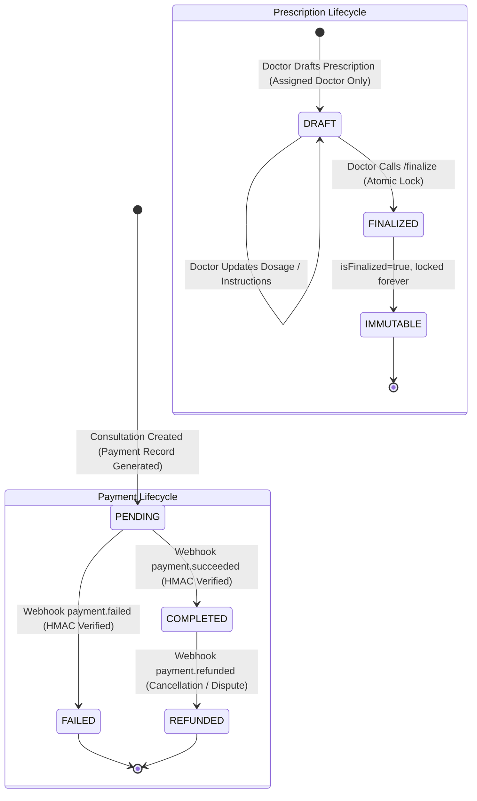

# Amrutam Telemedicine Platform — System Architecture & Design Specification

## 1. System Purpose & Scope

The **Amrutam Telemedicine Platform** is an enterprise-grade backend engineered to support modern, secure, and resilient telehealth operations. It provides core clinical workflows:
- Secure patient and medical practitioner onboarding, identity management, and credential lifecycle with multi-factor authentication (MFA).
- Doctor specialization directories and interval-validated availability scheduling.
- High-concurrency consultation reservation with database-enforced anti-double-booking guarantees and idempotent request replay.
- Electronic prescription lifecycle with clinical immutability and audit non-repudiation.
- Asynchronous financial transaction verification using cryptographic payment webhooks.
- Reliable asynchronous job execution via a Transactional Outbox pattern and BullMQ worker queues.
- Three-pillar observability with OpenTelemetry distributed tracing, Prometheus metrics exposition, and correlated structured logging.

---

## 2. Modular Monolith Architecture

The platform is designed as a **Modular Monolith**. Rather than adopting premature microservices complexity, business domains are partitioned into cohesive, bounded modules with clean boundaries, encapsulated data access, and decoupled asynchronous messaging.



---

## 3. Module Responsibilities & Architectural Layers

### 3.1 Layering Model
Each domain module adheres to a strict three-tier structure:
1. **Controller / HTTP Layer**: Unpacks HTTP requests, extracts authentication context (`req.user`), validates incoming query and body payloads using Zod schemas, and returns standardized JSON envelopes.
2. **Service Layer**: Coordinates business invariants, executes domain logic, orchestrates atomic database transactions (`prisma.$transaction`), publishes outbox events, and updates Prometheus metrics counters.
3. **Data Access Layer**: Interacts with PostgreSQL 16 via Prisma ORM client singleton with connection pooling and typed relational constraints.

### 3.2 Domain Modules Overview

| Module | Core Responsibilities | Key Invariants Enforced |
| :--- | :--- | :--- |
| **Auth (`src/modules/auth`)** | Registration, credential validation, token rotation, TOTP MFA, profile management. | Enforces `PATIENT` role on public signup; Argon2id password hashing; single-use SHA-256 hashed refresh tokens with instant replay invalidation. |
| **Doctors (`src/modules/doctors`)** | Directory search, profile verification, and time-interval availability slot creation. | Prevents overlapping availability intervals for the same doctor via application logic and PostgreSQL constraints. |
| **Consultations (`src/modules/consultations`)** | Appointment scheduling, slot locking, idempotency processing, cancellation, and status transitions. | Anti-double-booking via database row locks (`SELECT FOR UPDATE`) and `AvailabilitySlot` uniqueness; Idempotency-Key request hashing. |
| **Prescriptions (`src/modules/prescriptions`)** | Clinical prescription drafting, structured medication validation, and finalization locking. | Only assigned doctor can create/finalize; once `isFinalized: true`, record is permanently immutable; audit log emitted. |
| **Payments (`src/modules/payments`)** | Webhook intake, cryptographic HMAC verification, state machine updates, and duplicate deduplication. | HMAC-SHA256 signature verification with constant-time equality check; `WebhookEvent` table deduplication; row-locked updates. |
| **Outbox (`src/modules/outbox`)** | Reliable background message polling and queue delivery. | Events written in same database transaction as domain state; polled using `SELECT ... FOR UPDATE SKIP LOCKED` to prevent double processing. |
| **Health & Telemetry (`src/modules/health`)** | Liveness, readiness, and metrics exposition. | `/healthz` tests event loop; `/readyz` tests PostgreSQL and Redis with 2500ms bounded timeout; `/metrics` exposes Prometheus exposition format. |

---

## 4. Key Workflows & Sequence Diagrams

### 4.1 High-Concurrency Consultation Booking Workflow



### 4.2 Transactional Outbox to BullMQ Worker Pipeline



### 4.3 Payment Webhook & Prescription Lifecycle

> [!NOTE]
> **Implementation Status**: The platform implements a **Simulated Payment Gateway** (`src/modules/payments/simulated-gateway.ts`) that mimics production payment webhooks (e.g. Razorpay/Stripe) with genuine HMAC-SHA256 signatures, constant-time verification, and idempotent state transitions. It does not initiate external HTTP calls to real banking networks.



---

## 5. Security & Trust Boundaries

```
[ UNTRUSTED PUBLIC INTERNET ]
            |
            | (Boundary 1: TLS 1.3 Termination, Helmet CSP, CORS Whitelist)
            v
[ NETWORK PERIMETER: Ingress & Distributed Rate Limiter ]
  - Auth endpoints: 15 req / 15 min (FAIL_CLOSED on Redis outage)
  - Booking endpoints: 20 req / 10 min
  - General API: 100 req / 15 min
            |
            | (Boundary 2: Authentication & RBAC Middleware)
            v
[ APPLICATION CORE: Express 5 Modular Monolith ]
  - JWT Verification (15-min short-lived access tokens)
  - Refresh Token Rotation (SHA-256 hashed in DB, instant replay detection)
  - Object-Level Ownership: requireOwnershipOrAdmin (Anti-BOLA/IDOR)
  - Clinical Authorization: Consultation-Doctor binding enforcement
            |
            | (Boundary 3: Internal Secured Network / Subnet)
            v
[ PERSISTENCE & DATA LAYER ]
  - PostgreSQL 16: Parameterized SQL (Prisma), btree_gist constraints, row-locks
  - Redis 7: Rate limits, cache, and BullMQ queues
```

---

## 6. Observability & Telemetry Architecture

1. **Structured Correlated Logs (Pino)**:
   - Every HTTP request receives a unique `correlationId` and `requestId`.
   - Pino mixin queries `@opentelemetry/api` to inject active `trace_id` and `span_id`.
   - Sensitive fields (`password`, `accessToken`, `refreshToken`, `mfaSecret`, `diagnosis`, `medications`) are stripped by built-in Pino redaction rules.
2. **Prometheus Metrics (`/metrics`)**:
   - Gathers HTTP RPS, duration histograms, rate-limit rejections, PostgreSQL/Redis availability gauges, outbox backlog, and BullMQ queue stats.
   - Low-cardinality route normalization strips UUIDs and IDs to prevent memory leaks and PHI exposure.
   - Protected via `METRICS_AUTH_TOKEN`.
3. **OpenTelemetry Distributed Tracing**:
   - Instruments Express, HTTP client, Redis, and Prisma queries.
   - Exports via OTLP (`OTEL_EXPORTER_OTLP_ENDPOINT`) to an OpenTelemetry Collector or Grafana Tempo.
4. **Grafana Dashboards**:
   - Provisioned locally on port `3001` with real-time panels for infrastructure health, latency percentiles (p50, p95, p99), error rates, and outbox throughput.

---

## 7. Scaling to 100,000 Daily Consultations: Capacity Analysis

### 7.1 Throughput Mathematics
- **Daily Volume**: 100,000 consultations / day.
- **Average Throughput**: $\frac{100,000}{86,400\text{ s}} \approx 1.16\text{ bookings/sec}$.
- **Peak Traffic Analysis**: In telehealth, consultation bookings do not arrive evenly throughout 24 hours. Typically, **70% of traffic occurs within a 6-hour window** (e.g., 8:00 AM – 11:00 AM and 5:00 PM – 8:00 PM):
  $$\text{Peak Booking Throughput} = \frac{70,000}{6 \times 3,600\text{ s}} \approx 3.24\text{ bookings/sec}$$
  Accounting for a 3x traffic surge during marketing promotions or morning slot releases:
  $$\text{Target Peak Capacity} = 10\text{ to }15\text{ booking transactions/sec}$$
- **Read-to-Write Ratio**: Telemedicine platforms have an estimated 20:1 read-to-write ratio (patients browsing doctors, checking slot availability, viewing past prescriptions, querying notifications):
  $$\text{Target Peak Read Volume} = 15 \times 20 = 300\text{ to }500\text{ HTTP Requests/sec (RPS)}$$

### 7.2 Scaling Strategies & Bottleneck Mitigations

| Architectural Component | Current Bottleneck | Scaling Strategy for 100k Consultations |
| :--- | :--- | :--- |
| **API Web Tier** | Single Node.js event loop instance (capped at ~1,000 RPS). | Run 4–8 stateless Express replicas behind an AWS ALB or NGINX ingress with horizontal pod autoscaling (HPA) based on CPU and HTTP latency. |
| **PostgreSQL Concurrency** | Row locks on `availability_slots` and connection pool exhaustion. | 1. Enable read replicas (AWS Aurora or Pgpool-II) for doctor directories and search.<br>2. PgBouncer connection pooling in transaction mode.<br>3. Partial index on `availability_slots(doctorId, startTime) WHERE status = 'AVAILABLE'` to keep index trees tiny. |
| **Redis Capacity** | In-memory key eviction during traffic spikes. | Redis cluster or AWS ElastiCache with multi-AZ replication. Memory requirement for 100k consultations: rate-limit counters + idempotency keys (~100MB RAM, easily handled by a 2GB cluster). |
| **BullMQ Worker Scaling** | Background job backlog during bulk reminder dispatches. | Decouple worker processes from API servers. Scale BullMQ worker replicas independently to consume from notification queues without competing for API CPU. |
| **Outbox Dispatcher** | Polling latency on `outbox_events` table. | Outbox poller uses `SKIP LOCKED` across multiple replicas. Add partitioning to `outbox_events` table by date, archiving processed events to cold storage daily. |

---

## 8. Architectural Decision Records (ADRs) & Trade-offs

1. **Modular Monolith vs. Microservices**:
   - *Decision*: Build a Modular Monolith with strict module boundaries.
   - *Rationale*: For an early-to-mid stage telemedicine platform handling 100k daily consultations, microservices introduce distributed transaction overhead, network latency, and operational fragility. A modular monolith provides relational ACID transactions for booking correctness while remaining straightforward to deploy and maintain.
2. **PostgreSQL Row Locks (`SELECT FOR UPDATE`) vs. Optimistic Locking**:
   - *Decision*: Enforce pessimistic row locking on `availability_slots` during consultation creation.
   - *Rationale*: Optimistic locking (`version` column) causes high retry failure rates under slot race conditions (popular doctors). Pessimistic locking queues simultaneous requests cleanly, guaranteeing that exactly one transaction reserves the slot while others fail immediately with HTTP 409 without retry overhead.
3. **Transactional Outbox vs. Dual Writes**:
   - *Decision*: Use the Transactional Outbox pattern committed in the same PostgreSQL transaction.
   - *Rationale*: Dual writing (writing to database, then directly publishing to Redis/Kafka) risks catastrophic inconsistency if the network drops between writes. The transactional outbox guarantees that an event is recorded if and only if the business transaction succeeds.
4. **Pessimistic Fail-Closed Rate Limiting on Auth**:
   - *Decision*: Fail closed on authentication endpoints if Redis goes offline.
   - *Rationale*: While failing open preserves availability, failing open on authentication leaves patient accounts vulnerable to unthrottled brute-force attacks during infrastructure degradation. Security takes precedence over availability for auth.

---

## 9. Known Limitations & Production Prerequisites

1. **Simulated Payment Gateway**: The current codebase models payment workflows via `SimulatedPaymentGateway`. For commercial launch, this module must be connected to an authorized payment service provider (e.g. Razorpay PG API) using production API keys.
2. **MFA Recovery Mechanism**: Account recovery when a user loses their TOTP authenticator currently requires manual DBA or administrator reset. Production requires automated single-use hashed recovery scratch codes.
3. **Single Database Primary**: While current schema constraints prevent data corruption, high availability requires an active-standby database failover cluster (e.g., AWS RDS Multi-AZ).
4. **Load Testing Verification**: Mathematical capacity projections must be validated using realistic load-testing suites (k6 or Artillery) against scaled infrastructure before public production claims are made.
