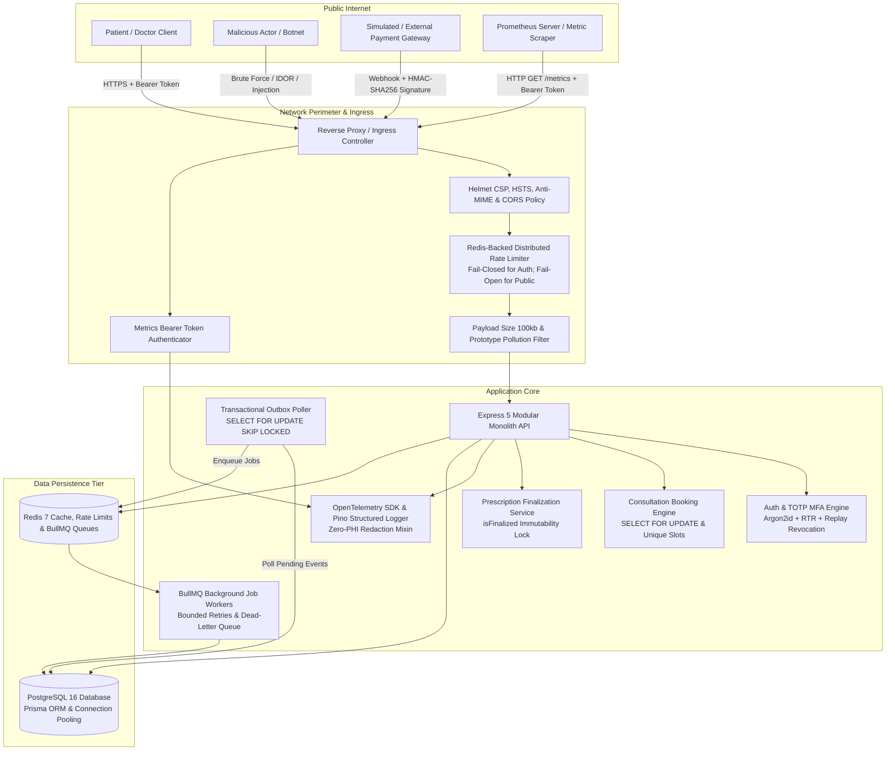

# Amrutam Telemedicine Platform — STRIDE Threat Model & Security Architecture Review

## 1. System Overview & Architecture

The **Amrutam Telemedicine Platform** is an enterprise-grade backend modular monolith engineered with Node.js, Express 5, TypeScript, PostgreSQL 16, Redis 7, Prisma ORM, BullMQ, and OpenTelemetry. It processes sensitive patient health information (PHI), clinical consultation schedules, doctor availability, electronic prescriptions, payment webhooks, and asynchronous notifications.



---

## 2. Identified Assets & Sensitivity Classification

| Asset | Sensitivity | Description | Impact of Compromise |
| :--- | :--- | :--- | :--- |
| **Patient Health Information (PHI)** | **CONFIDENTIAL (CRITICAL)** | Clinical diagnoses, prescribed medications, dosages, medical instructions, consultation reasons. | Major patient privacy breach, medical identity theft, severe regulatory penalties. |
| **Authentication & Session Secrets** | **CONFIDENTIAL (CRITICAL)** | Argon2id password hashes, JWT signing keys, TOTP MFA seeds, refresh token hashes. | Mass account takeover, impersonation of physicians or system administrators. |
| **Financial & Webhook Data** | **CONFIDENTIAL (HIGH)** | Webhook HMAC signing secret (`PAYMENT_WEBHOOK_SECRET`), transaction references, consultation fees. | Financial fraud, consultation provisioning without payment, unauthorized refunds. |
| **Clinical Scheduling State** | **INTEGRITY (HIGH)** | Doctor availability slots, consultation booking timestamps, cancellation records. | Double bookings, doctor calendar corruption, denial of patient care. |
| **Audit Logs & Telemetry Data** | **INTEGRITY (MEDIUM)** | Cryptographic tracking of logins, role elevation, prescription edits, and Prometheus metrics. | Impaired forensic investigations, metric label cardinality explosion, telemetry tampering. |

---

## 3. Trust Boundaries & Threat Actor Profiles

### Trust Boundaries
1. **Boundary 1 (Client to Ingress / API)**: Public untrusted network crossing into infrastructure perimeter. All inputs are considered untrusted, malformed, or malicious.
2. **Boundary 2 (Ingress to Application Core)**: Transported headers (`X-Forwarded-For`), HTTP headers, request body size limits, and CORS origins.
3. **Boundary 3 (Application Core to Data Tier)**: Internal secured network connecting Express processes to PostgreSQL 16 and Redis 7.
4. **Boundary 4 (Observability & Scrape Interface)**: The `/metrics` endpoint and Grafana dashboard interface, exposing process memory, infrastructure availability, and business rates.

### Threat Actor Profiles
- **Anonymous External Attacker**: Script kiddies, automated botnets seeking unauthenticated endpoints, DDoS targets, or brute-force access.
- **Malicious Authenticated Patient**: Enrolled patient attempting privilege escalation (becoming DOCTOR/ADMIN) or IDOR attacks to view other patients' medical records or prescriptions.
- **Compromised or Rogue Doctor**: Authorized physician attempting to alter finalized prescriptions, falsify consultations, or access patients outside their assigned caseload.
- **Payment Webhook Impersonator**: Malicious actor forging payment confirmation webhooks to obtain free consultations.
- **Telemetry Eavesdropper / Scraper**: Unauthorized internal or external network actor attempting to scrape `/metrics` or access default Grafana dashboards to harvest infrastructure topology.

---

## 4. Comprehensive STRIDE Threat Analysis Matrix

| Threat | Telemedicine Scenario | Risk | Implemented Mitigation | Verification Source | Residual Risk | Status |
| :--- | :--- | :--- | :--- | :--- | :--- | :--- |
| **S - Spoofing** | Credential stuffing & brute-force login attacks | **HIGH** | Argon2id hashing (64MB RAM, 3 iterations); Redis distributed rate limiting (15 req/15 min) with **FAIL_CLOSED** policy; generic error messages defeating email enumeration. | `src/modules/auth/auth.service.ts`, `tests/security/auth.test.ts` | Distributed botnets rotating thousands of residential IPs under per-IP thresholds. | **IMPLEMENTED** |
| **S - Spoofing** | Refresh token replay / session hijacking | **CRITICAL** | Single-use refresh tokens stored as SHA-256 hashes. Refresh Token Rotation (RTR). Replay detection immediately terminates all sessions for the compromised user account. | `src/modules/auth/auth.service.ts`, `tests/security/auth.test.ts` | Compromise of client-side device storage where the single-use token resides. | **IMPLEMENTED** |
| **S - Spoofing** | Forged payment gateway webhooks | **CRITICAL** | HMAC-SHA256 signature verification with constant-time equality check (`crypto.timingSafeEqual`) in `SimulatedPaymentGateway`. | `src/modules/payments/simulated-gateway.ts`, `tests/security/prescription-payment.test.ts` | Compromise of the shared `PAYMENT_WEBHOOK_SECRET` environment variable. | **IMPLEMENTED** |
| **S - Spoofing** | Reverse proxy IP header spoofing (`X-Forwarded-For`) | **MEDIUM** | Strict Express `trust proxy` configuration (`TRUST_PROXY=false` default; specific CIDR in production). | `src/common/middleware/rate-limit.middleware.ts`, `tests/security/security-hardening.test.ts` | Misconfiguration of upstream load balancer in cloud deployment. | **IMPLEMENTED** |
| **T - Tampering** | Post-consultation prescription tampering | **CRITICAL** | Database transactions with row locks (`SELECT ... FOR UPDATE`), permanent `isFinalized: true` lock, 400 rejection on update attempts. | `src/modules/prescriptions/prescription.service.ts`, `tests/security/prescription-payment.test.ts` | Direct unauthorized access to PostgreSQL database by rogue database administrator. | **IMPLEMENTED** |
| **T - Tampering** | Object prototype pollution | **MEDIUM** | Recursive input sanitization middleware rejecting `__proto__`, `prototype`, and `constructor` keys with HTTP 400. | `src/common/middleware/security.middleware.ts`, `tests/security/security-hardening.test.ts` | Zero-day deserialization vulnerabilities in third-party npm dependencies. | **IMPLEMENTED** |
| **R - Repudiation** | Denial of prescription creation or consultation cancellation | **MEDIUM** | Comprehensive database-backed `AuditLog` records containing `actorId`, `action`, `entityId`, `ipAddress`, and `correlationId`. | `src/modules/prescriptions/prescription.service.ts`, `src/modules/consultations/consultation.service.ts` | Log deletion if administrative PostgreSQL credentials are leaked. | **IMPLEMENTED** |
| **I - Info Disclosure** | PHI / credential leakage in server logs & traces | **CRITICAL** | Pino structured logger configured with automatic redaction for tokens, passwords, secrets, diagnosis, and medications; OpenTelemetry `withSpan` scalar-only attributes. | `src/common/logging/logger.ts`, `src/infrastructure/telemetry/tracer.ts`, `tests/observability/observability.test.ts` | Developer accidentally calling `console.log()` directly instead of structured logger. | **IMPLEMENTED** |
| **I - Info Disclosure** | Cross-patient medical record access (IDOR / BOLA) | **CRITICAL** | Strict RBAC and resource ownership middleware (`requireOwnershipOrAdmin`) verified at route and service layers. | `src/modules/auth/auth.middleware.ts`, `tests/security/auth.test.ts` | Developer omitting ownership check on newly developed endpoints. | **IMPLEMENTED** |
| **I - Info Disclosure** | Metric label cardinality explosion & PHI leakage | **HIGH** | Express route templates (`req.route.path`) and fallback regex `normalizeRoutePath()` replace UUIDs and IDs with `:id`. Strips query strings. | `src/infrastructure/telemetry/metrics.ts`, `tests/observability/observability.test.ts` | Custom metrics added in the future with dynamic label values. | **IMPLEMENTED** |
| **I - Info Disclosure** | Unauthorized scrape of `/metrics` endpoint | **MEDIUM** | Bearer token authorization via `METRICS_AUTH_TOKEN` environment variable; rejects unauthorized requests with HTTP 401. | `src/modules/health/health.controller.ts`, `tests/observability/observability.test.ts` | Scraper token leakage or running without `METRICS_AUTH_TOKEN` set. | **IMPLEMENTED** |
| **D - Denial of Service** | Consultation slot race conditions / double bookings | **HIGH** | PostgreSQL `btree_gist` slot exclusion constraints, single-capacity active consultation unique index, row-level locks (`SELECT FOR UPDATE`), and dedicated booking rate limiter (20 req/10 min). | `src/modules/consultations/consultation.service.ts`, `tests/concurrency/booking-concurrency.test.ts` | High volume of legitimate cancellations and re-bookings causing lock contention. | **IMPLEMENTED** |
| **D - Denial of Service** | Redis outage causing rate limiter bypass | **HIGH** | Defensive dual-tier policy: Sensitive auth and booking endpoints enforce `FAIL_CLOSED`, returning HTTP 500/503 during Redis outages. Public read routes fail open. | `src/common/middleware/rate-limit.middleware.ts`, `tests/security/security-hardening.test.ts` | Prolonged Redis downtime rendering authentication temporarily unavailable. | **IMPLEMENTED** |
| **D - Denial of Service** | Outbox worker poison pills & queue starvation | **MEDIUM** | BullMQ bounded retries (5 attempts) with exponential backoff and jitter. Unrecoverable failures routed to Dead-Letter Queue (DLQ). | `src/workers/notification.worker.ts`, `tests/unit/outbox-queue.test.ts` | Large influx of unprocessable outbox events exhausting worker concurrency. | **IMPLEMENTED** |
| **D - Denial of Service** | Memory exhaustion via oversized JSON payloads | **MEDIUM** | Express body-parser limit strictly clamped to `100kb` with automatic HTTP 413 `PAYLOAD_TOO_LARGE` rejection. | `src/app.ts`, `tests/security/security-hardening.test.ts` | High concurrency small payload HTTP connection floods (Slowloris). | **IMPLEMENTED** |
| **E - Elevation of Privilege** | Self-assigning DOCTOR or ADMIN role during registration | **HIGH** | Hardcoded `UserRole.PATIENT` assignment in `AuthService.registerPatient` and Zod schema omitting role inputs. | `src/modules/auth/auth.service.ts`, `tests/security/auth.test.ts` | Insider threat provisioning roles directly via database console. | **IMPLEMENTED** |
| **E - Elevation of Privilege** | Default Grafana dashboard credentials in production | **MEDIUM** | Grafana service in `docker-compose.yml` defaults to `admin`/`admin`. Configured for local development only. | `docker-compose.yml`, `docs/observability/local-monitoring.md` | Operator deploying Docker Compose stack to production without changing Grafana credentials. | **RECOMMENDED CONTROL** (Dev-only flag) |

---

## 5. In-Depth Attack Scenarios & Mitigations

### 5.1 Broken Object-Level Authorization (BOLA / IDOR)
- **Attack Vector**: Patient A logs in legitimately, receives a valid JWT, and sends `GET /api/v1/prescriptions/:prescriptionId` substituting the UUID of Patient B's prescription.
- **Implemented Mitigation**:
  1. The endpoint validates token authenticity via `authenticate`.
  2. In `prescription.service.ts`, the query retrieves the prescription and enforces:
     ```ts
     if (userRole !== 'ADMIN' && prescription.patientId !== userId && prescription.doctorId !== doctorId) {
       throw new ForbiddenError('Access to prescription denied');
     }
     ```
  3. Patient A receives HTTP 403 `FORBIDDEN` and a security audit event is logged.

### 5.2 Consultation Slot Races & Idempotency Misuse
- **Attack Vector 1 (Double Booking Race)**: Two patients simultaneously submit booking requests for Dr. Meera's sole 10:00 AM slot.
  - **Mitigation**: The transaction acquires an exclusive row lock (`SELECT * FROM availability_slots WHERE id = :slotId FOR UPDATE`). Exactly one patient acquires the lock, transitions the slot status to `RESERVED`, and commits. The second transaction immediately detects `status !== 'AVAILABLE'` and rolls back with HTTP 409 `CONFLICT`.
- **Attack Vector 2 (Idempotency Key Poisoning)**: An attacker reuses an existing `Idempotency-Key` with a completely different booking payload (e.g. Booking a different doctor for free).
  - **Mitigation**: The idempotency middleware stores the SHA-256 hash of the request payload. Reusing an existing key with a mismatched payload returns HTTP 409 `CONFLICT` without executing business logic.

### 5.3 Webhook Forgery & Replay Attacks
- **Attack Vector**: An adversary sends a forged `payment.succeeded` webhook to mark an unpaid consultation as confirmed.
- **Implemented Mitigation**:
  1. Incoming signature header is verified against `PAYMENT_WEBHOOK_SECRET` using `crypto.timingSafeEqual` in `SimulatedPaymentGateway`.
  2. The unique `eventId` is recorded in the `WebhookEvent` table under a database unique constraint. If replayed, the event is immediately flagged as duplicate and returns a cached 200 without state re-execution.

### 5.4 Telemetry PHI Leakage & Dashboard Access
- **Attack Vector**: An attacker queries Prometheus or intercepts application traces to discover patient medical diagnoses or therapy medications.
- **Implemented Mitigation**:
  1. Route paths are sanitized: `/api/v1/consultations/550e8400-e29b-41d4...` becomes `/api/v1/consultations/:id`.
  2. The Pino logger strips `diagnosis` and `medications` from all log events.
  3. The `/metrics` endpoint is protected via `METRICS_AUTH_TOKEN`.
  4. Grafana credentials default to `admin`/`admin` **for local development only**. In production, `GF_SECURITY_ADMIN_PASSWORD` must be provisioned via secret management and public access restricted.

---

## 6. Residual Risks & Future Architectural Recommendations

1. **Self-Service MFA Recovery (Recommended)**:
   - *Current State*: Lost authenticator recovery requires administrator assistance.
   - *Recommendation*: Generate 8 single-use emergency recovery codes during MFA enrollment, hashed with Argon2id and stored in a dedicated `mfa_recovery_codes` table.
2. **Web Application Firewall (WAF) & Cloud Ingress (Recommended)**:
   - *Current State*: Defensive rate limiting and header security operate inside Express.
   - *Recommendation*: Deploy AWS WAF or Cloudflare upstream to filter volumetric DDoS attacks, HTTP request smuggling, and Layer 7 botnets.
3. **Database-at-Rest Encryption (TDE) (Recommended)**:
   - *Current State*: Local PostgreSQL volume is unencrypted.
   - *Recommendation*: Enable AWS RDS AES-256 storage volume encryption or LUKS disk encryption for production datacenters.
4. **Automated Vulnerability Scanning (SAST/DAST) (Recommended)**:
   - *Recommendation*: Integrate `npm audit`, Snyk, and OWASP ZAP into the CI/CD pipeline to detect vulnerable transitive dependencies before deployment.

---

## 7. Regulatory & Compliance Notice

> [!WARNING]
> **FORMAL COMPLIANCE NOTICE**:
> The security controls documented above are essential technical prerequisites. However, **formal compliance with regulations such as HIPAA (United States), DISHA (Digital Information Security in Healthcare Act - India), or GDPR (European Union) CANNOT be claimed solely by implementing application code or software architecture**.
> 
> Full regulatory compliance requires:
> - Legally executed Business Associate Agreements (BAAs) with all hosting and third-party vendors.
> - Organizational operational policies, workforce security training, and documented breach notification protocols.
> - Physical datacenter access controls and disaster recovery drills.
> - Independent third-party security audits and ISO 27001 / SOC 2 Type II attestations.
